# Doctor Tracker
## 🔗 Live Demo

| | Link |
|---|---|
| **Frontend (Vercel)** | https://frontend-xi-eight-11.vercel.app |
| **Backend API (Render)** | https://doctor-tracker-uuc4.onrender.com/api |
| **Health check** | https://doctor-tracker-uuc4.onrender.com/api/health |

**Demo login:** `admin@doctortracker.com` / `Admin@12345`

> The backend runs on Render's free tier. The first request after inactivity can take 30–50 seconds while the server wakes up.

---

## Description

**Doctor Tracker** is a secure admin portal for clinics and hospital groups. Administrators can manage their roster of doctors, keep track of every patient under each doctor's care, and follow clinical activity on a live analytics dashboard (admissions over time, patient conditions, caseload per doctor, and more). It has a **Next.js** frontend and a separate **Express + MongoDB** REST API. The focus is on fast indexed queries, a polished responsive UI, and authentication that keeps the session token out of JavaScript's reach.

---

## Table of contents

1. [Features](#features)
2. [Tech stack](#tech-stack)
3. [Setup guide](#setup-guide)
4. [System architecture](#system-architecture)
5. [Technical decisions](#technical-decisions)
6. [Security](#security)
7. [API reference](#api-reference)
8. [Performance & optimization](#performance--optimization)
9. [Testing & CI](#testing--ci)
10. [Project structure](#project-structure)
11. [Visual evidence](#visual-evidence)
12. [Scalability considerations](#scalability-considerations)

---

## Features

| Area | What's included |
|---|---|
| **Authentication & security** | JWT in an `httpOnly` cookie, CSRF protection, account lockout, token revocation on logout or password change, change password with a strength policy, edge route protection plus API-level `requireAuth` + `requireRole('admin')`, an audit log of every sign-in and change. See [Security](#security) |
| **Doctors** | Create / edit / delete; list with **search** (name, email, phone), **filters** (specialization, hospital, joined date range), **sorting** (name, patients, joined), **pagination** with selectable page size |
| **Doctor detail** | Profile header, the doctor's own patient list (search, condition, admitted date range, sort, paginate), **add patient under doctor**, **remove patient** (optimistic) |
| **Patients** | Dedicated page: list, **edit**, **delete**, search (name, phone), filters (**condition**, doctor, gender, admitted date range), quick condition chips, sorting, pagination, a **slide-over patient record** you can link to (`/patients?view=<id>`) |
| **Activity log** | Paginated audit trail (who, what, when, which fields changed), filterable by record type and action |
| **Dashboard** | KPI cards (total doctors, total patients, new admissions with period-over-period trend, critical patients), admissions timeline, condition donut, **patients per doctor**, patients by specialization, age distribution. You can switch the range between 7D, 30D, 90D and 12M |
| **UX** | **Ctrl/⌘ + K command palette** (jump to any page, doctor or patient), **light and dark mode** (saved per user, follows the OS by default, no flash on load), responsive layout (sidebar on desktop, drawer on mobile, cards instead of tables on small screens), skeleton loaders, empty states, toasts, accessible dialogs (Esc, focus management, ARIA), skip link, reduced-motion support, server errors mapped onto form fields, URL-synced filters (shareable, refresh-safe, back-button friendly) |

## Tech stack

| Layer | Technology |
|---|---|
| Frontend | **Next.js 14 (App Router)**, React 18, Tailwind CSS, TanStack Query v5, React Hook Form + Zod, Recharts, lucide-react, sonner |
| Backend | **Node.js 20+, Express 4** (standalone server), Mongoose 8, Zod, jsonwebtoken, bcryptjs, helmet, express-rate-limit, compression |
| Quality | Vitest + Supertest + mongodb-memory-server (API tests), ESLint, GitHub Actions CI, Docker |
| Design | UI direction drafted in **Canva** ([design reference](https://canva.link/n5fv3ylh933zyz9)) and built as a token-based design system (CSS variables, Tailwind) |
| Database | **MongoDB 6+** (local, Docker, or Atlas) |
| API style | RESTful JSON, consistent `{ success, data, pagination?, message?, errors? }` envelope |

---

## Setup guide

### Prerequisites
- Node.js **20 or newer** and npm
- MongoDB **6.0+** running locally, via Docker (`docker compose up -d` in the repo root), or a MongoDB Atlas connection string

### Option A: Local (Node + MongoDB)

#### 1. Clone
```bash
git clone <your-repo-url> doctor-tracker
cd doctor-tracker
```

#### 2. Backend (Express API)
```bash
cd backend
cp .env.example .env          # then edit MONGODB_URI and JWT_SECRET
npm install
npm run seed                  # creates the admin user + ~40 doctors / ~900 patients of demo data
npm run dev                   # → http://localhost:5000/api
```
Check that it is up: `curl http://localhost:5000/api/health`

> `npm run seed -- --reset` wipes and regenerates the demo doctors and patients.

#### 3. Frontend (Next.js)
In a second terminal:
```bash
cd frontend
cp .env.example .env.local    # API_URL=http://localhost:5000, JWT_SECRET = same value as the backend
npm install
npm run dev                   # → http://localhost:3000
```

#### 4. Sign in
| Email | Password |
|---|---|
| `admin@doctortracker.com` | `Admin@12345` |

(Change these with `SEED_ADMIN_EMAIL` / `SEED_ADMIN_PASSWORD` in `backend/.env` before seeding.)

### Environment variables

Both apps ship an `.env.example` with every variable documented:

| Variable | App | Purpose |
|---|---|---|
| `MONGODB_URI` | api | MongoDB connection string |
| `JWT_SECRET` | api + web | ≥ 32 chars. Generate with `openssl rand -base64 48`. **The API refuses to start in production with the example value** |
| `JWT_EXPIRES_IN`, `JWT_ISSUER`, `JWT_AUDIENCE` | api (+ web) | Session lifetime (default `8h`) and the token claims checked on every request |
| `CLIENT_ORIGIN` | api | Allowed frontend origin(s) for CORS and the CSRF origin check |
| `LOGIN_MAX_ATTEMPTS`, `LOGIN_LOCK_MINUTES` | api | Account lockout policy (default: 5 attempts → 15 min) |
| `AUDIT_RETENTION_DAYS` | api | Audit log TTL (default 180) |
| `API_URL` | web | Where Next.js proxies `/api/*` |

### Option B: Docker (whole stack)
```bash
cp backend/.env.example backend/.env           # set JWT_SECRET to a real random value
cp frontend/.env.example frontend/.env.local   # same JWT_SECRET
docker compose up --build -d
docker compose exec api node src/scripts/seed.js
# → http://localhost:3000
```
MongoDB is not exposed to the host, both app containers run as the non-root `node` user, and the API has a health check.

### Production build (without Docker)
```bash
cd backend && npm run sync-indexes && npm start
cd frontend && npm run build && npm start
```

---

## System architecture

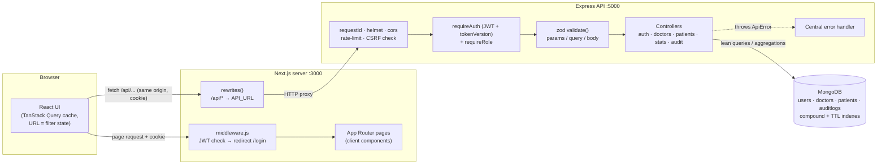

**Request flow**

1. **Page navigation.** `middleware.js` runs before any protected page renders. If the `dt_token` cookie is missing, expired or has a bad signature (checked with `jose` when `JWT_SECRET` is set), the user is redirected to `/login?next=…`. A user who is already signed in and opens `/login` is sent to `/dashboard`.
2. **Data fetching.** Client components call `fetch('/api/...')` on the **same origin**. `next.config.mjs` rewrites those calls to the Express server, so the `httpOnly` cookie is first-party: no CORS preflights and no third-party-cookie problems.
3. **API pipeline.** Security middleware runs first (request id, security headers, rate limit, then the CSRF origin + token check on writes), then `requireAuth` (verifies the JWT and checks that its `tokenVersion` is still current) and `requireRole('admin')`. Next, `validate()` parses and coerces params, query and body with Zod into `req.valid`. The controller runs lean, index-backed queries. Any thrown error goes to one error handler, which normalises Zod, Mongoose cast/validation and duplicate-key (11000) errors into the same JSON shape.
4. **Caching and invalidation.** TanStack Query caches each list by its full parameter object. Mutations invalidate hierarchical keys (`['doctors']`, `['patients']`, `['stats']`), so the dashboard is never stale after an edit.

**Data model**

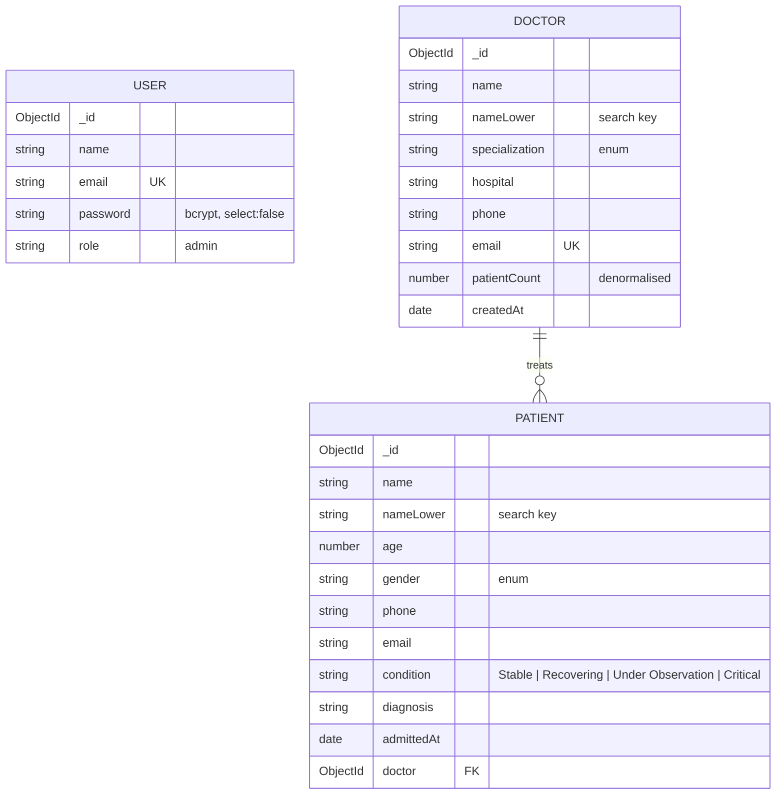

---

## Technical decisions

### 1. Indexes designed from the query shapes: ESR compound indexes, prefix search on normalised fields, and a denormalised `patientCount`

**Problem.** The three heaviest operations are (a) searching, filtering and sorting large lists, (b) showing each doctor's patient count in the list, and (c) the "patients per doctor" chart. The obvious implementations are slow at scale:

- `{ name: /term/i }` is a case-insensitive, unanchored regex. **It cannot use a B-tree index efficiently**, so MongoDB scans every key or document.
- Showing patient counts with `$lookup` + `$size`, or a `$group` over the whole `patients` collection, costs O(patients) on **every** doctor-list request and every dashboard load.

**Decision.**

- **Index per query shape, following the ESR rule** (Equality → Sort → Range). For example, `{ doctor: 1, admittedAt: -1 }` serves "this doctor's patients, newest first, within a date range" from the index alone. The same goes for `{ condition: 1, admittedAt: -1 }` and `{ specialization: 1, createdAt: -1 }`.
- **Prefix search on a lowercase copy of the name.** A `pre('validate')` hook keeps `nameLower` in sync. Searches use an **anchored, case-sensitive** regex, `^term`, which MongoDB turns into a tight index range scan (`["term", "tern")`). Name, email and phone are combined with `$or`. Each branch has its own index, so the planner can use an `OR` plan that merges index scans. User input is escaped before it goes into the regex, which also blocks ReDoS patterns.
- **A denormalised `patientCount` on each doctor**, kept correct with atomic `$inc` on create, delete and reassignment of a patient. The list's "Patients" column becomes a plain field read. "Sort by most patients" and the dashboard's top-doctors chart become `find().sort({ patientCount: -1 }).limit(50)` on the `{ patientCount: -1 }` index, which reads at most 50 small documents instead of every patient.

**Trade-offs.**

- Prefix search finds "Rah…" but not "…ahim". For an admin directory, typing the start of a name is the common case. If true substring or fuzzy search is ever needed, the next step is **MongoDB Atlas Search**, not an unindexed regex.
- The counter has to be maintained on every write path. All such writes go through two controllers (`bumpCount` helper), so the rule is easy to enforce. On a replica set, the two writes could be wrapped in a transaction for strict atomicity, and a nightly `$group` reconciliation job could guard against drift.
- Offset pagination (`skip`) is fine at this scale. For very deep pages, the endpoints can switch to **keyset pagination** on `(sortField, _id)`. Every sort already ends with `_id` as a tiebreaker, so this needs no index change.

### 2. TanStack Query + the URL as state, instead of Redux or Context

**Problem.** Almost all of this app's state is **server state**: lists, details and stats that live in MongoDB. The client-only state is UI state such as which modal is open, plus filter state (search, page, sort, filters). Putting server data in Redux or Context means writing caching, request de-duplication, loading and error flags, refetch-after-mutation and stale-while-revalidate by hand. Context also re-renders every consumer on any change.

**Decision.**

- **TanStack Query owns server state.** Each list is cached under its full parameter object (`['doctors', 'list', { page, search, … }]`).
  - `placeholderData: keepPreviousData` keeps the current rows on screen while the next page or filter loads, so the table never flashes to a spinner.
  - The **next page is prefetched**, so "Next" is usually instant.
  - The `AbortSignal` is passed to `fetch`, so stale requests are cancelled when filters change quickly.
  - Patient deletes and removals are **optimistic**: the row disappears at once and is restored if the API fails.
  - **Hierarchical query keys** let one `invalidateQueries({ queryKey: ['doctors'] })` refresh lists, details and nested patient lists together, and every mutation also invalidates `['stats']`.
- **The URL owns filter state** through a small `useUrlState` hook. Filtered views are shareable links (for example, a link to `/patients?condition=Critical` from the dashboard donut legend). They survive refresh and work with the back button. Changing any filter resets `page` to 1.
- **Local `useState` owns UI state**, such as the modal that is open and the row being edited.
- Re-renders stay low:
  - Search text lives in local state and is **debounced**, so the URL and the query update once per pause, not on every keystroke.
  - Rows are `React.memo` components with `useCallback` handlers.
  - Recharts (~100 kB) is loaded with `next/dynamic` and `ssr: false`, so it never blocks the first paint.

**Trade-offs.** The app has no global client store. If complex cross-page client state appears later (for example a multi-step wizard or offline drafts), a small store such as Zustand would be added for that slice only. Server data would stay in TanStack Query.

### Other notable decisions (brief)

- **Next.js proxy instead of direct CORS calls.** The cookie stays first-party with `SameSite=Lax`, the browser never sees the API origin, and CSRF exposure is limited.
- **`httpOnly` JWT cookie instead of `localStorage`.** Injected scripts cannot read the token, which reduces the damage an XSS bug can do. The API also accepts `Authorization: Bearer` for non-browser clients.
- **Defense in depth for route protection.** The edge middleware blocks protected pages, and the API independently re-verifies the JWT and role on every call.
- **Zod on both sides.** The client gives instant feedback. The server is authoritative: it strips unknown fields and coerces types, and `query parser: 'simple'` blocks `?field[$ne]=` operator injection.
- **Parallel aggregations for the dashboard** rather than one giant `$facet`. Each pipeline starts with its own indexed `$match`, or reads the counter, and they run concurrently with `Promise.all`. Totals use `estimatedDocumentCount()` (collection metadata, O(1)).

---

## Security

The portal holds patient data, so security is layered: every control below has a second one behind it.

| Threat | Mitigation | Where |
|---|---|---|
| **Session theft via XSS** | JWT lives in an `httpOnly`, `SameSite=Lax`, `Secure` (production) cookie, so JavaScript never sees it. A strict Content-Security-Policy (`default-src 'self'`, `frame-ancestors 'none'`, `object-src 'none'`) limits what injected script could do. React escapes all output, and there is no `dangerouslySetInnerHTML` with user data | `middleware/auth.js`, `next.config.mjs` |
| **CSRF** | Three layers: (1) SameSite cookies, (2) an **Origin/Referer allow-list** on every POST/PATCH/DELETE, (3) a **double-submit token**: the `X-CSRF-Token` header must equal the `dt_csrf` cookie, compared in constant time. The token rotates on login | `middleware/csrf.js`, `lib/api.js` |
| **Brute force / credential stuffing** | Rate limit per IP + email on `/auth/login` (10 per 15 min). **Account lockout** after 5 failures for 15 min. Global API rate limit | `routes/authRoutes.js`, `controllers/authController.js` |
| **User enumeration** | The same error for unknown email and wrong password, and a **constant-time path** (a bcrypt compare against a dummy hash when the user doesn't exist) | `authController.login` |
| **Stolen or leaked token** | `tokenVersion` is embedded in every JWT. **Logout and password change increment it**, which revokes every existing token at once. Short 8 h sessions | `models/User.js`, `middleware/auth.js` |
| **JWT forgery / algorithm confusion** | The algorithm is pinned to `HS256`, with `iss` and `aud` checked on the API and at the edge. A ≥ 32-char secret is enforced, and the example secret is rejected in production | `middleware/auth.js`, `src/middleware.js`, `config/env.js` |
| **Weak passwords** | bcrypt (cost 12). Change-password policy: ≥ 10 chars with upper, lower, number and symbol, current password required, live checklist in the UI | `validators/auth.js`, `ChangePasswordModal` |
| **NoSQL injection** | Express `query parser: 'simple'` (no nested objects), **Zod validation of every param, query and body** before it reaches Mongoose, and user regex input escaped | `app.js`, `middleware/validate.js`, `utils/query.js` |
| **Mass assignment** | Request bodies use `.strict()` schemas: unknown fields such as `patientCount`, `role` or `_id` are rejected with 400 | `validators/*.js` |
| **Broken access control** | Edge middleware blocks protected pages. The API independently enforces `requireAuth` + `requireRole('admin')` on every data route. Nested deletes are scoped (`{ _id, doctor }`), so a patient can only be removed through their own doctor | `routes/index.js`, `patientController` |
| **Open redirect** | `?next=` only accepts same-site paths (`/…`, not `//…`) | `LoginForm.jsx` |
| **Clickjacking, MIME sniffing, leakage** | `X-Frame-Options: DENY`, `nosniff`, `Referrer-Policy`, `Permissions-Policy`, HSTS (production), and `Cache-Control: no-store` on all API responses | `next.config.mjs`, `app.js` |
| **DoS** | 50 kB JSON body limit, page size capped at 100, search length capped, rate limits, and server header and request timeouts (slow-loris) | `app.js`, `server.js`, validators |
| **Error leakage** | One central error handler. Stack traces only outside production. Every response carries an `X-Request-Id` for support without exposing internals | `middleware/errorHandler.js`, `middleware/requestId.js` |
| **Accountability** | An **append-only audit log** records sign-ins, failed sign-ins, lockouts and every create, update and delete, with actor, IP, user agent and changed **field names**. No patient values are copied into logs. It is auto-expired with a TTL index | `models/AuditLog.js`, `utils/audit.js` |
| **Supply chain** | `npm audit --audit-level=high` runs in CI | `.github/workflows/ci.yml` |

**Not in scope for this task (and the next steps in production):** MFA/TOTP for admins, encryption of sensitive fields at rest (MongoDB CSFLE / Queryable Encryption), a Redis store for rate limits across instances, and centralised log shipping (e.g. Datadog or ELK) with alerting on `account_locked` events.

---

## API reference

Base URL: `/api`. Every route except `/health`, `/auth/csrf` and `/auth/login` needs authentication. Every POST, PATCH and DELETE needs the `X-CSRF-Token` header.

| Method | Endpoint | Description |
|---|---|---|
| GET | `/health` | Liveness check |
| GET | `/auth/csrf` | Issues the CSRF token cookie (the SPA calls this before its first write) |
| POST | `/auth/login` | `{ email, password }` → sets the session and CSRF cookies (rate-limited, lockout) |
| POST | `/auth/logout` | Revokes all tokens (`tokenVersion++`) and clears the cookies |
| GET | `/auth/me` | Current user |
| PATCH | `/auth/password` | `{ currentPassword, newPassword }`; signs out other sessions |
| GET | `/audit-logs` | Paginated audit trail. Query: `page, limit, entity, action` |
| GET | `/doctors` | List. Query: `page, limit, search, specialization, hospital, from, to, sort=createdAt\|name\|patientCount, order=asc\|desc` |
| GET | `/doctors/meta` | Filter options (specializations, distinct hospitals) |
| GET | `/doctors/options` | Lightweight `{ _id, name, specialization }[]` for selects |
| POST | `/doctors` | Create `{ name, specialization, hospital, phone, email }` |
| GET | `/doctors/:id` | Doctor detail |
| PATCH | `/doctors/:id` | Update (partial) |
| DELETE | `/doctors/:id` | Delete the doctor and cascade-delete their patients |
| GET | `/doctors/:id/patients` | That doctor's patients (same query params as `/patients`) |
| POST | `/doctors/:id/patients` | Add a patient under the doctor |
| DELETE | `/doctors/:id/patients/:patientId` | Remove a patient from the doctor (scoped delete) |
| GET | `/patients` | List. Query: `page, limit, search, condition, gender, doctor, from, to, sort=admittedAt\|name\|age, order` |
| POST | `/patients` | Create (with `doctor` id) |
| GET | `/patients/:id` | Patient detail |
| PATCH | `/patients/:id` | Update (partial; reassigning the doctor updates both counters) |
| DELETE | `/patients/:id` | Delete |
| GET | `/stats/overview?range=7d\|30d\|90d\|12m` | Dashboard aggregates |

**Response envelope**
```json
{ "success": true, "data": [ ... ], "pagination": { "page": 1, "limit": 10, "total": 132, "totalPages": 14 } }
{ "success": false, "message": "Validation failed", "errors": { "email": ["Enter a valid email"] } }
```

---

## Performance & optimization

| Concern | Implementation |
|---|---|
| Indexing | ESR compound indexes per query shape (see `models/*.js`), unique email indexes, `autoIndex` off in production plus `npm run sync-indexes` as a deploy step |
| Search | Anchored prefix regex on normalised fields, so it uses the index; input escaped |
| Filtering | Equality filters lead the compound indexes, and date ranges are the trailing range key |
| Pagination | `find().skip().limit()` and `countDocuments()` run **in parallel**; stable sort with an `_id` tiebreaker; `limit` capped at 100 |
| Payload size | `.lean()` plus explicit projections; gzip via `compression`; minimal `populate` (doctor name and specialization only) |
| Dashboard | Parallel targeted aggregations, `estimatedDocumentCount`, denormalised counter for patients per doctor, missing buckets filled server-side, `Cache-Control: private, max-age=30` |
| Frontend renders | Debounced search, memoised rows and callbacks, `keepPreviousData`, next-page prefetch, request abort, charts code-split with `next/dynamic`, `optimizePackageImports` for lucide and recharts |
| Robustness | Zod validation on every input, central error mapping, no retries on 4xx, graceful shutdown |

---

## Testing & CI

```bash
cd backend && npm test      # Vitest + Supertest against an in-memory MongoDB (no setup needed)
```

The API suite covers the parts that matter most for correctness and security:

- **Auth:** unauthenticated access is rejected; the session cookie is `HttpOnly` + `SameSite`; the same error is returned for an unknown user and a wrong password; **lockout** after N failures; a **replayed token after logout is rejected**.
- **CSRF:** a missing token gives 403, and a foreign `Origin` gives 403.
- **Input hardening:** `?field[$ne]=` injection gives 400, unknown body fields give 400, and responses carry a request id.
- **Doctors:** prefix search, filters, pagination metadata, and duplicate email → 409.
- **Patients:** the `patientCount` counter stays correct across add, reassign and delete; scoped delete through the wrong doctor → 404; condition filter; audit entries are written and IPs are not exposed.
- **Stats:** totals, patients per doctor, and a timeline with zero-filled buckets.

GitHub Actions (`.github/workflows/ci.yml`) runs lint, tests, the production build and `npm audit` on every push and PR.

---

## Project structure

```
doctor-tracker/
├── backend/
│   ├── src/
│   │   ├── config/        # env validation (zod), db connection
│   │   ├── models/        # User, Doctor, Patient, AuditLog + indexes, constants
│   │   ├── validators/    # zod schemas per resource
│   │   ├── middleware/    # auth (JWT + roles), csrf, requestId, validate, errorHandler
│   │   ├── controllers/   # auth, doctor, patient, stats, audit
│   │   ├── routes/        # REST routers, auth gate in routes/index.js
│   │   ├── utils/         # ApiError, asyncHandler, audit, query helpers (paginate, prefix, dateRange)
│   │   ├── scripts/       # seed.js, syncIndexes.js
│   │   ├── app.js         # express app factory
│   │   └── server.js      # bootstrap + graceful shutdown
│   ├── tests/             # Vitest + Supertest API tests
│   ├── Dockerfile
│   └── .env.example
├── frontend/
│   ├── src/
│   │   ├── app/           # App Router: login, (app)/dashboard, doctors, doctors/[id], patients, activity
│   │   ├── components/
│   │   │   ├── ui/        # Button, Field/Input/Select, Modal, ConfirmDialog, Pagination, SearchInput, …
│   │   │   ├── layout/    # AppShell, Sidebar, Topbar, CommandPalette, UserMenu, ThemeToggle
│   │   │   ├── dashboard/ # StatCard, ChartCard, Charts (recharts), ActivityFeed, DashboardView
│   │   │   ├── activity/  # ActivityView (audit log)
│   │   │   ├── doctors/   # DoctorsView, DoctorDetailView, DoctorFormModal
│   │   │   └── patients/  # PatientsView, PatientsTable, PatientDrawer, PatientFormModal
│   │   ├── hooks/         # useUrlState, useDebounce, useTheme, useAuth, useDoctors, usePatients, useStats, useAudit
│   │   ├── lib/           # api client, services, query keys, zod schemas, formatters
│   │   └── middleware.js  # edge route protection
│   ├── next.config.mjs    # /api proxy, security headers (CSP, HSTS…), standalone output
│   ├── Dockerfile
│   └── .env.example
├── .github/workflows/ci.yml
├── docs/screenshots/
└── docker-compose.yml     # mongo + api + web
```

---

## Visual evidence

> Screenshots are taken from the running app with the seeded demo data. Save them in `docs/screenshots/` with these names.

| View | Desktop | Mobile |
|---|---|---|
| Login | 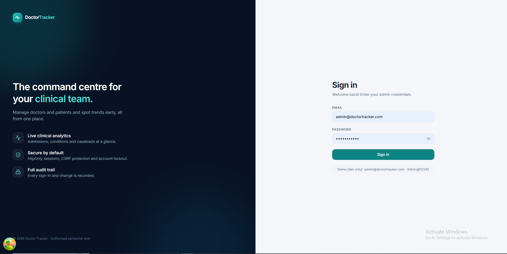 | 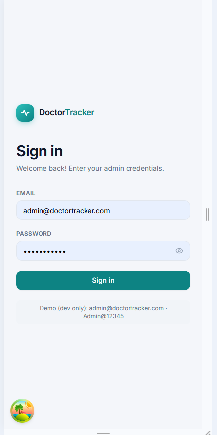 |
| Dashboard | 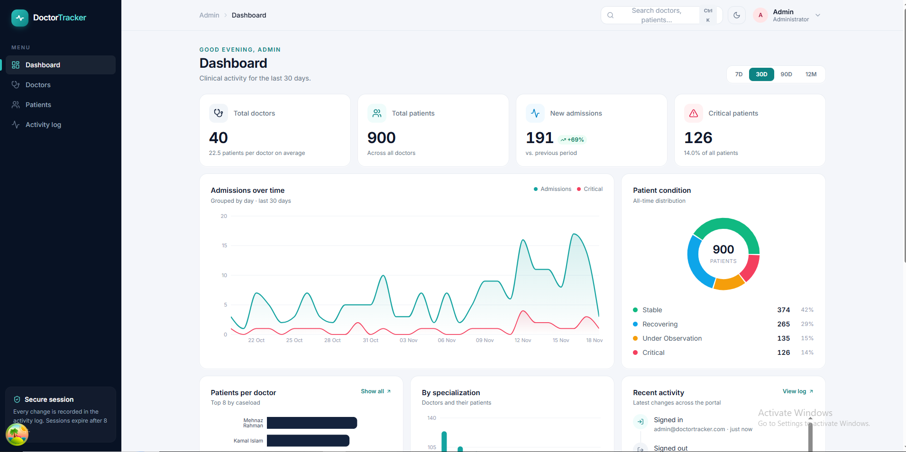 | 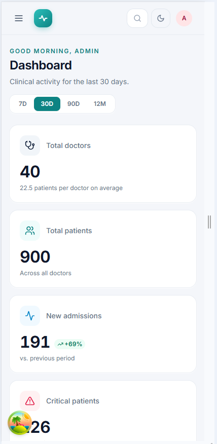 |
| Doctors | 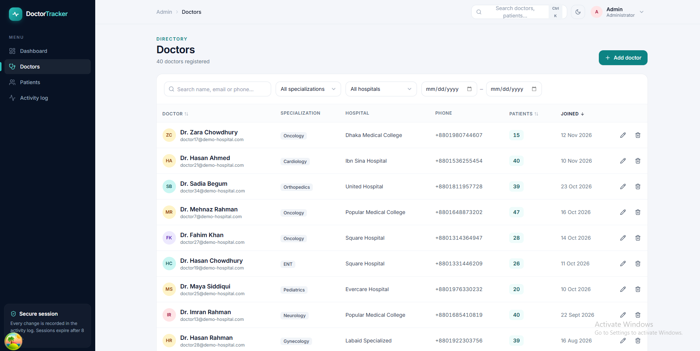 | 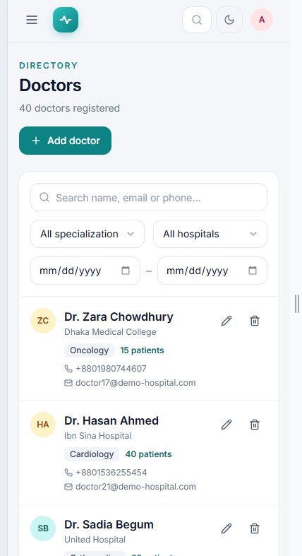 |
| Doctor detail | 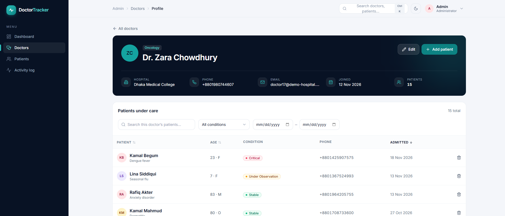 |  |
| Patients | 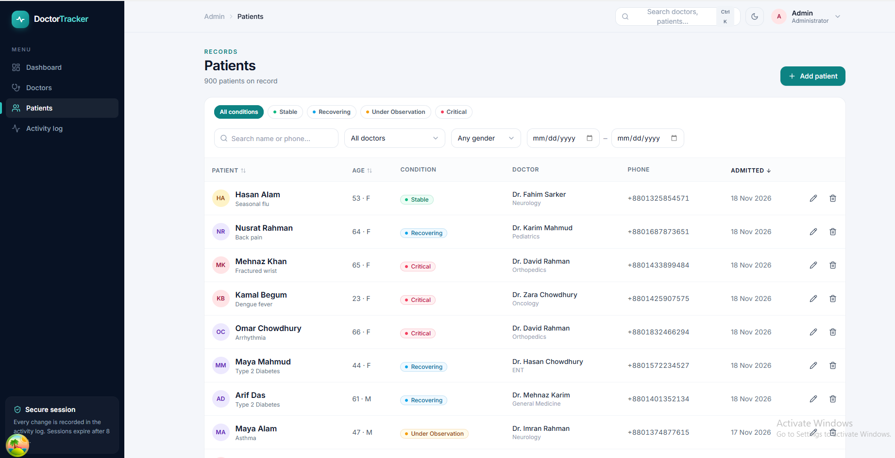 | 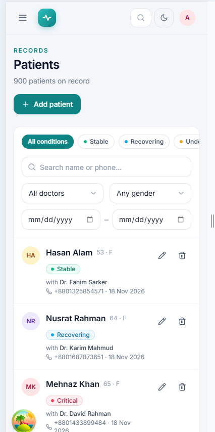 |
| Patient record (slide-over) | 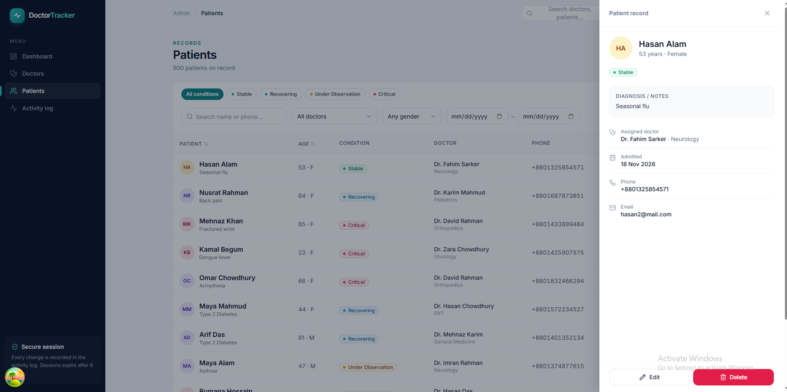 | 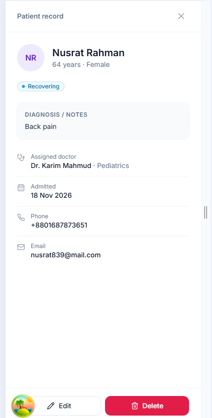 |
| Command palette (Ctrl/⌘+K) | 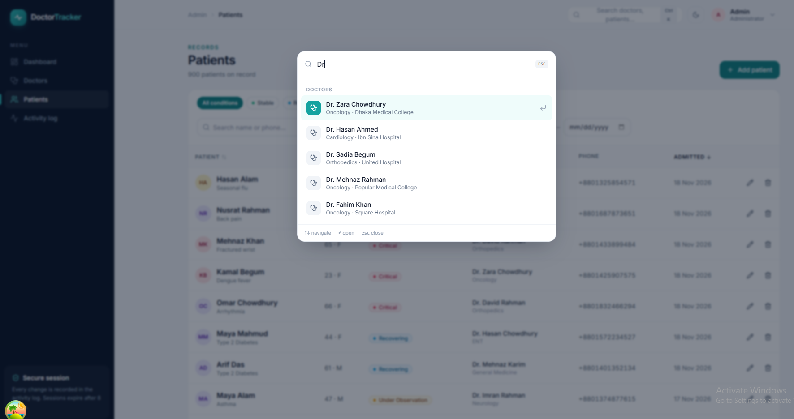 | — |
| Dark mode | 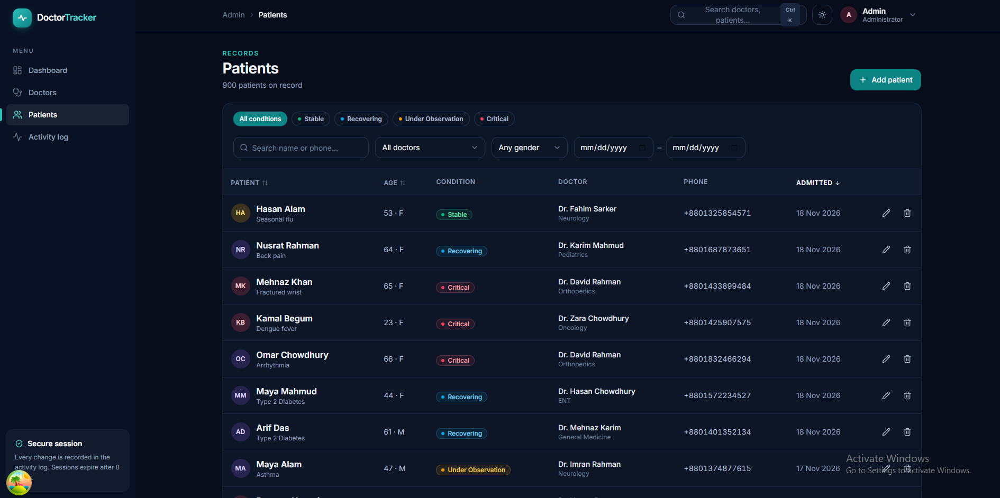 | 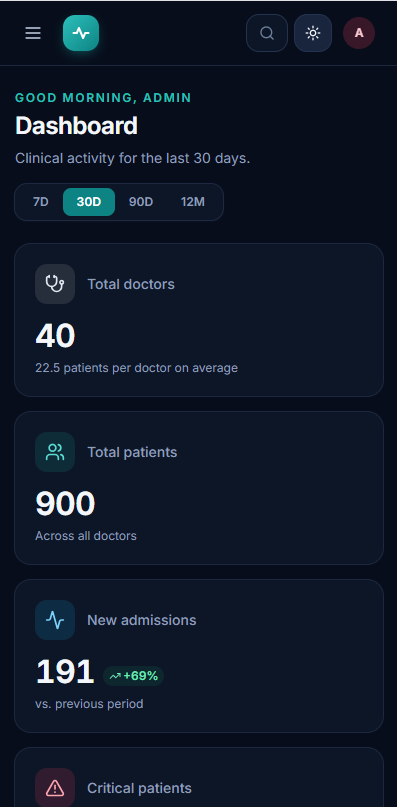 |

*Tip: in Chrome DevTools, use device mode (iPhone 14 Pro, 393×852) and the "Capture full size screenshot" command.*

---

## Scalability considerations

- **Stateless API.** The JWT means any number of Express instances can run behind a load balancer (revocation is one indexed `tokenVersion` read per request), and the rate limiter can move to a Redis store.
- **Database.** Indexes match query shapes. Reads can go to secondaries for the dashboard. `patients` can be sharded on `{ doctor: 1, _id: 1 }` if needed.
- **Deep pagination.** The query layer is ready for keyset pagination, because sorts already end in `_id`.
- **Dashboard.** If data grows to millions of rows, the aggregates can be pre-computed into a `daily_stats` collection by a scheduled job or change streams, or cached in Redis. The endpoint contract would not change.
- **Search.** Atlas Search can be added for fuzzy and substring matching without changing the API.
